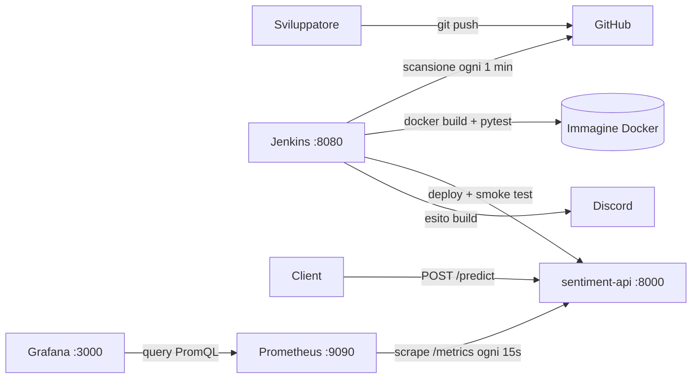

# Sentiment Analysis API — Deploy e monitoraggio

Servizio REST che espone un modello di Sentiment Analysis (recensioni in inglese → `positive` / `negative` / `neutral`), con pipeline CI/CD su Jenkins e monitoraggio con Prometheus e Grafana.

Ogni modifica segue lo stesso percorso, senza interventi manuali: **commit → build → test → deploy → notifica → monitoraggio**.

---

## Indice
1. [Architettura](#architettura)
2. [Struttura del repository](#struttura-del-repository)
3. [Prerequisiti](#prerequisiti)
4. [Configurazione da zero](#configurazione-da-zero)
5. [Uso dell'API](#uso-dellapi)
6. [Pipeline CI/CD](#pipeline-cicd)
7. [Monitoraggio](#monitoraggio)
8. [Test](#test)
9. [Manutenzione](#manutenzione)
10. [Scelte architetturali e limiti](#scelte-architetturali-e-limiti)

---

## Architettura



Tutti i componenti girano come container Docker sulla stessa macchina:

| Componente | Ruolo | Porta |
|---|---|---|
| `sentiment-api` | API FastAPI che serve il modello | 8000 |
| `jenkins` | Pipeline CI/CD (comanda il Docker dell'host via `docker.sock`) | 8080 |
| `prometheus` | Raccolta e storico delle metriche | 9090 |
| `grafana` | Dashboard in tempo reale | 3000 |

`sentiment-api`, `prometheus` e `grafana` condividono la rete Docker `monitoring` e si raggiungono per nome del container.

---

## Struttura del repository

```
├── app/
│   └── main.py                  # API: /predict, /health, /metrics
├── model/
│   └── sentiment_analysis_model.pkl
├── tests/
│   ├── conftest.py              # fixture condivise (TestClient)
│   ├── test_unit.py             # validazione input, funzione di predizione
│   └── test_integration.py      # endpoint, formato risposte, metriche, errori
├── jenkins/
│   ├── Dockerfile               # Jenkins + client Docker
│   └── docker-compose.yml
├── monitoring/
│   ├── docker-compose.yml       # Prometheus + Grafana
│   ├── prometheus/prometheus.yml
│   └── grafana/
│       ├── provisioning/        # datasource e dashboard caricati all'avvio
│       └── dashboards/sentiment-api.json
├── Dockerfile                   # immagine del servizio
├── docker-compose.yml           # avvio locale del solo servizio (sviluppo)
├── Jenkinsfile                  # pipeline CI/CD
├── pytest.ini
└── requirements.txt
```

---

## Prerequisiti

- Docker Desktop (su Windows con backend WSL2)
- Git
- Python 3.12 (solo per lo sviluppo locale senza Docker)
- Un account GitHub e un webhook Discord per le notifiche

---

## Configurazione da zero

### 1. Clonare il repository
```bash
git clone https://github.com/citcla-beep/sentiment-api-devops.git
cd sentiment-api-devops
```

### 2. Avviare Jenkins
```bash
cd jenkins
docker compose up -d --build
docker exec jenkins cat /var/jenkins_home/secrets/initialAdminPassword
```
Aprire http://localhost:8080, inserire la password, scegliere **Install suggested plugins** e creare l'utente admin.

### 3. Creare le credenziali in Jenkins
*Manage Jenkins → Credentials → System → Global credentials*:

| ID | Tipo | Valore |
|---|---|---|
| `github-token` | Username with password | utente GitHub + Personal Access Token (scope `repo`, `admin:repo_hook`) |
| `discord-webhook` | Secret text | URL del webhook Discord |

### 4. Creare il job
*New Item* → `sentiment-api` → **Multibranch Pipeline**:
- **Branch Sources**: GitHub, credenziale `github-token`, URL del repository
- **Build Configuration**: by Jenkinsfile
- **Scan Repository Triggers**: *Periodically if not otherwise run* → 1 minute

Alla prima scansione la build di `main` esegue il deploy dell'API.

### 5. Avviare il monitoraggio
```bash
cd monitoring
docker compose up -d
```
- Prometheus: http://localhost:9090/targets (i target devono risultare UP)
- Grafana: http://localhost:3000 (`admin` / password in `monitoring/.env`, default `admin`) → *Dashboards → Sentiment API*

Per impostare la password di Grafana creare `monitoring/.env` (escluso da Git):
```
GRAFANA_ADMIN_PASSWORD=una-password-sicura
```

---

## Uso dell'API

Documentazione interattiva: http://localhost:8000/docs

### `POST /predict`
```bash
curl -X POST http://localhost:8000/predict \
  -H "Content-Type: application/json" \
  -d '{"review": "This product is amazing! I love it."}'
```
```json
{"sentiment": "positive", "confidence": 0.5683}
```

| Caso | Codice | Risposta |
|---|---|---|
| Recensione valida | 200 | `{"sentiment": "...", "confidence": ...}` |
| Campo mancante, vuoto, solo spazi, tipo errato, JSON malformato, testo > 5000 caratteri | 422 | `{"error": "Input non valido", "details": [...]}` |
| Errore interno del modello | 500 | `{"detail": "Errore durante la predizione"}` |

### `GET /health`
```json
{"status": "ok", "model_loaded": true}
```
Usato dall'healthcheck Docker e dallo smoke test della pipeline.

### `GET /metrics`
Metriche in formato Prometheus (vedi [Monitoraggio](#monitoraggio)).

---

## Pipeline CI/CD

Definita nel [`Jenkinsfile`](Jenkinsfile).

| Stage | Cosa fa | Branch |
|---|---|---|
| **Checkout** | Scarica il codice e ricava il tag dell'immagine dallo SHA del commit | tutti |
| **Build** | `docker build -t sentiment-api:<sha>` | tutti |
| **Test** | Esegue pytest *dentro* l'immagine appena costruita, pubblica il report JUnit | tutti |
| **Deploy** | Sostituisce il container `sentiment-api` con la nuova immagine | solo `main` |
| **Smoke test** | Verifica `/health` e una predizione reale sul servizio rilasciato | solo `main` |

- **Cancello di qualità**: se uno stage fallisce, i successivi vengono saltati, quindi il codice con test falliti non arriva mai in produzione.
- **Strategia dei branch**: sviluppo su `feature/*`, merge su `main` tramite Pull Request (`main` è protetto). Sui branch feature la pipeline esegue solo build e test.
- **Trigger**: scansione del repository ogni minuto (vedi [Scelte architetturali](#scelte-architetturali-e-limiti)).
- **Notifiche**: un messaggio Discord a fine pipeline, sia in caso di successo sia di errore, con il link alla build.
- **Tracciabilità**: ogni immagine è etichettata con lo SHA del commit da cui è costruita.

---

## Monitoraggio

### Metriche esposte dal servizio

| Metrica | Tipo | Descrizione |
|---|---|---|
| `http_request_duration_seconds` | Histogram | Tempo di risposta per endpoint |
| `http_requests_total` | Counter | Richieste per endpoint, metodo e codice di stato |
| `prediction_errors_total` | Counter | Eccezioni durante l'inferenza |
| `predictions_total` | Counter | Predizioni per sentiment |
| `prediction_confidence` | Histogram | Distribuzione della confidence |
| `process_cpu_seconds_total` | Counter | CPU usata dal processo |
| `process_resident_memory_bytes` | Gauge | Memoria usata dal processo |

### Dashboard Grafana

La dashboard viene caricata automaticamente tramite provisioning, si aggiorna ogni 5 secondi e mostra gli ultimi 15 minuti.

| Sezione | Pannelli |
|---|---|
| Panoramica | Servizio attivo, Richieste/s, Latenza p95, % errori 5xx, Errori di predizione |
| Prestazioni | Richieste/s per endpoint e codice, Latenza p50/p95/p99 |
| Errori | Tasso di errore 4xx/5xx, Errori di predizione nel tempo |
| Risorse | CPU %, Memoria |
| Modello | Predizioni per sentiment, Confidence media |

<!-- Inserire gli screenshot: -->
<!--  -->
<!--  -->

### Generare traffico di prova (PowerShell)
```powershell
$frasi = @("This product is amazing! I love it.", "Terrible, a total waste of money", "It was okay, nothing special", "   ")
1..200 | ForEach-Object {
    $body = @{ review = ($frasi | Get-Random) } | ConvertTo-Json
    try { Invoke-RestMethod -Method Post -Uri http://localhost:8000/predict -ContentType "application/json" -Body $body | Out-Null } catch {}
    Start-Sleep -Milliseconds 300
}
```

---

## Test

```bash
pytest -v                                  # in locale (venv attivo)
docker run --rm sentiment-api:dev pytest -v   # dentro l'immagine (come in pipeline)
```

- **Unit test** (`test_unit.py`): validazione dell'input, classi del modello, predizioni attese su frasi note, range della confidence, logica isolata con un modello finto.
- **Integration test** (`test_integration.py`): `/health`, formato della risposta di `/predict`, input non validi (422), JSON malformato, esposizione e incremento delle metriche, errore del modello simulato (500 + `prediction_errors_total`).

---

## Manutenzione

### Aggiornare il modello
1. Sostituire `model/sentiment_analysis_model.pkl` su un branch feature.
2. Aggiornare in `tests/` le frasi attese, se il nuovo modello si comporta diversamente.
3. Aprire la PR: la pipeline verifica che il modello si carichi e produca le previsioni attese prima del merge.

> Il modello è stato serializzato con **scikit-learn 1.6.0**: la versione in `requirements.txt` deve restare allineata, altrimenti il caricamento può fallire.

### Aggiornare le dipendenze
Modificare le versioni in `requirements.txt` su un branch: i test in pipeline verificano la compatibilità.

### Rollback a una versione precedente
```bash
docker images sentiment-api            # elenco dei tag (SHA dei commit)
docker rm -f sentiment-api
docker run -d --name sentiment-api --network monitoring -p 8000:8000 \
  --restart unless-stopped sentiment-api:<sha-precedente>
```
In alternativa, fare il revert del commit su `main`: la pipeline rilascerà automaticamente la versione ripristinata.

### Rinnovare il token GitHub
Il Personal Access Token ha una scadenza. Generarne uno nuovo e aggiornare la credenziale `github-token` in Jenkins.

### Risoluzione dei problemi

| Sintomo | Causa probabile | Soluzione |
|---|---|---|
| Build Jenkins di ~2 s senza stage | `Jenkinsfile` vuoto o non salvato | Verificare il contenuto del file su GitHub |
| `permission denied` su `docker.sock` | Jenkins senza accesso al Docker dell'host | Verificare `user: root` e il mount del socket in `jenkins/docker-compose.yml` |
| Smoke test fallito | Servizio non avviato o porta occupata | `docker logs sentiment-api`, verificare che la porta 8000 sia libera |
| Target `sentiment-api` DOWN in Prometheus | Container non sulla rete `monitoring` | `docker network connect monitoring sentiment-api` |
| Pannelli Grafana vuoti | Nessun traffico | Eseguire lo script di traffico di prova |
| Notifica Discord non ricevuta | URL del webhook errato | Aggiornare la credenziale `discord-webhook` |

---

## Scelte architetturali e limiti

| Scelta | Motivazione | In un ambiente di produzione reale |
|---|---|---|
| **FastAPI** | Validazione automatica con Pydantic, documentazione `/docs` generata | — |
| **Test dentro l'immagine** | Si testa esattamente l'artefatto che verrà rilasciato | Build multi-stage per escludere pytest dall'immagine finale |
| **Polling ogni minuto invece del webhook** | Jenkins gira in locale e non è raggiungibile da GitHub | Webhook GitHub verso un Jenkins esposto (o tunnel ngrok) |
| **Jenkins con `user: root`** | Accesso semplice a `docker.sock` in ambiente locale | Utente dedicato nel gruppo `docker` con permessi minimi |
| **Docker-outside-of-Docker** | Jenkins riusa il Docker dell'host, senza Docker annidato | Agent Jenkins dedicati o build su Kubernetes |
| **CPU/RAM dal processo invece di cAdvisor** | Metriche già esposte da `prometheus_client`; cAdvisor è poco affidabile su Docker Desktop per Windows | cAdvisor o node-exporter per le metriche di host e container |
| **Deploy su container locale** | Ambiente di staging su singola macchina | Push su un registry e deploy su server/Kubernetes |
| **Security scan** | Controlla le dipendenze contro il database delle vulnerabilità note (pip-audit) | tutti |


**Limiti del modello**: il modello fornito (CountVectorizer + MultinomialNB) conosce circa 117 parole. La confidence è spesso moderata (es. 0.57 per la frase di esempio) e i testi con sole parole sconosciute ricevono una predizione di default (`negative`, ~0.34). È un comportamento del modello, non del servizio.

